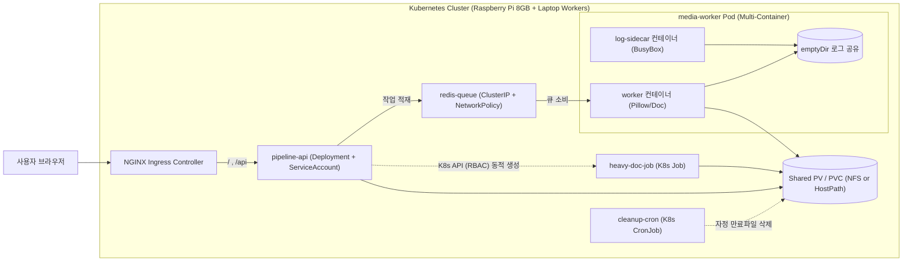

# CKA 실습 & 포트폴리오 프로젝트 설계서 (`Kube-Pipeline`)

> **목적**: 새 워크스페이스(세션)에서 이어서 작업하기 위한 아키텍처, 하드웨어 토폴로지, 기술 스택 및 CKA 연계 로드맵 정리 문서입니다.
> 새 세션 시작 시 **"@CKA_KUBE_PIPELINE_PLAN.md 읽고 Step 1부터 진행하자"**라고 요청하시면 바로 이어서 작업할 수 있습니다.

---

## 1. 보유 하드웨어 및 클러스터 역할 분담 (Topology)

기존 OCI에서 운영 중인 `dew-platform` 프로젝트를 내리지 않고 안전하게 유지하면서, 보유 장비를 최대한 활용하는 하이브리드 구조입니다.

| 장비 | 사양 | 클러스터 역할 | 전원 운영 방식 | 핵심 CKA 학습 포인트 |
| :--- | :--- | :--- | :--- | :--- |
| **라즈베리파이 5/4** | **RAM 8GB** (ARM64) | **`k8s-control-plane` (마스터 노드 + 기본 상시 워커)** | **24시간 상시 구동** (저전력) | `kubeadm init`, `etcd` 백업/복구, Control-plane Taint 해제, 상시 파드(API, Redis) 구동 |
| **서브 노트북** | **RAM 16GB** (x86_64) | **`k8s-worker-1` (고성능 워커 노드)** | **공부/실습 시에만 On** (평소 Off) | `kubeadm join`, 노드 점검(`cordon`, `drain`, `uncordon`), `NotReady` 노드 복구 및 파드 Eviction 확인 |
| **메인 노트북** | **RAM 32GB** (x86_64) | **개발 PC (VS Code / Git / 원격 `kubectl` 제어)** + 필요시 추가 VM 워커 | 작업 시 사용 | 로컬에 `~/.kube/config` 가져와서 원격 클러스터 제어, 매니페스트 작성 및 Git 커밋 |
| **OCI 인스턴스** | Always Free VM | **`dew-platform` 상시 운영 서버** (추후 Tailscale 연동 또는 K8s 확장 가능) | 24시간 상시 구동 | 기존 서비스 무중단 유지 (필요시 추후 멀티클러스터/Ingress 연동) |

### 💡 노트북 전원 On/Off 운영 원칙
* **평소(노트북 Off)**: 마스터 노드인 **라즈베리파이 8GB**가 혼자서도 기본 파드들을 실행할 수 있도록 Control-plane Taint(`node-role.kubernetes.io/control-plane:NoSchedule`)를 해제해 둡니다.
* **공부 시작(노트북 On)**: 노트북 부팅 시 `kubelet`이 자동 실행되어 클러스터에 `Ready` 상태로 합류하며, `kubectl uncordon`으로 무거운 워커 파드들을 배치합니다.
* **공부 종료(노트북 Off 전)**: `kubectl drain <노트북노드> --ignore-daemonsets --delete-emptydir-data` 명령어로 파드를 라즈베리파이로 안전하게 대피시킨 뒤 종료합니다 (CKA 필수 시험 문제 반복 숙달).

---

## 2. 프로젝트 주제: 분산 미디어/문서 처리 워커 파이프라인 (`Kube-Pipeline`)

사용자가 이미지나 문서(PDF/Markdown/Text)를 업로드하면, 백그라운드 워커 파드들과 K8s `Job`이 비동기로 **이미지 리사이징·워터마크 합성** 및 **문서 파싱·키워드 요약 리포트 생성**을 수행하고 공유 스토리지에 저장하는 파이프라인입니다.

### 기술 스택 (외부 유료 API 없이 100% 오픈소스/로컬 동작)
* **API & K8s Controller (`pipeline-api`)**:
  * **Python 3.12 + FastAPI + 공식 `kubernetes` Python Client**
  * 파일 업로드 수신, 작업 상태 조회, 대용량 문서 업로드 시 K8s API를 직접 호출해 **배치 `Job` 파드를 동적으로 생성**
* **Message Queue & State (`redis-queue`)**:
  * **Redis (Alpine)** — 초경량 작업 큐 및 파드별 처리 상태 저장
* **Async Worker (`media-worker`)**:
  * **Python Worker (`Pillow` 이미지 처리 + `PyMuPDF`/Markdown 문서 분석)**
  * 어느 노드(라즈베리파이 vs 노트북)의 어느 파드(`HOSTNAME`)가 처리했는지 메타데이터 기록
* **Log Sidecar (`log-shipper`)**:
  * **BusyBox / Fluent-bit** — 워커 파드 내부에 함께 떠서 `emptyDir` 볼륨을 공유하며 처리 로그를 포맷팅·스트리밍
* **Web Dashboard (`pipeline-ui`)**:
  * **FastAPI + Jinja2/HTMX + Tailwind CSS** (단일 경량 이미지 또는 프론트 분리)
  * 파일 드래그&드롭 업로드, 실시간 파드/노드별 처리 현황 시각화

---

## 3. 시스템 아키텍처 다이어그램



---

## 4. CKA 시험 도메인 100% 매핑 & Git 디렉토리 구조

새로 생성할 Git 저장소(`kube-pipeline`)의 추천 폴더 구조와 단계별 커밋 플랜입니다:

```text
kube-pipeline/
├── README.md
├── CKA_KUBE_PIPELINE_PLAN.md          # 현재 설계 문서
├── app/                               # 애플리케이션 소스 코드 ( 멀티 아키텍처 지원 )
│   ├── api/                           # FastAPI + Web UI + K8s Job 생성 클라이언트
│   └── worker/                        # Pillow 이미지 변환 & 문서 요약 워커
├── k8s/                               # CKA 도메인별 쿠버네티스 매니페스트 & 스크립트
│   ├── 01-cluster-setup/              # [배점 25%] kubeadm 설치, containerd 설정, CNI, etcd 백업 스크립트
│   ├── 02-storage-config/             # [배점 10%] Namespace, ConfigMap, Secret, PV, PVC, StorageClass
│   ├── 03-workloads-sidecar/          # [배점 15%] Deployment, Readiness/Liveness Probe, Sidecar Pod, Resource Limits
│   ├── 04-jobs-rbac-scheduling/       # [배점 25%] ServiceAccount, Role, RoleBinding, Job, CronJob, NodeAffinity/Taint
│   ├── 05-networking-security/        # [배점 20%] ClusterIP, NodePort, Ingress, NetworkPolicy(DB/Redis 격리)
│   └── 06-troubleshooting-scenarios/  # [배점 30%] 일부러 장애를 내고 복구하는 시나리오 스크립트 & 풀이 기록
```

---

## 5. 새 세션에서 바로 시작할 첫 번째 체크리스트 (Step 1)

1. **새 폴더 생성 및 이동**:
   * 원하는 경로에 `kube-pipeline` 폴더를 생성하고 이 `CKA_KUBE_PIPELINE_PLAN.md` 파일을 옮깁니다.
2. **라즈베리파이 8GB 환경 확인**:
   * OS: **Ubuntu Server 22.04 LTS 또는 24.04 LTS (64-bit)** 설치 및 메인 노트북에서 SSH 접속 확인
3. **첫 작업 지시**:
   * 새 세션에서 에이전트에게 **`"CKA_KUBE_PIPELINE_PLAN.md 참고해서 k8s/01-cluster-setup 폴더와 라즈베리파이 kubeadm 마스터 노드 구축 스크립트부터 만들어줘"`** 라고 요청하면 즉시 시작됩니다!
